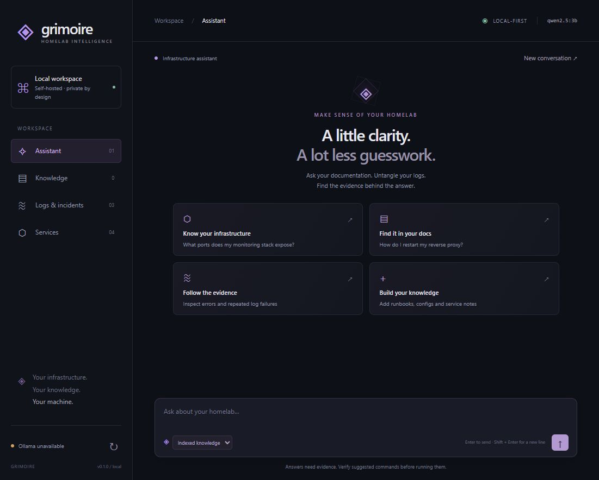
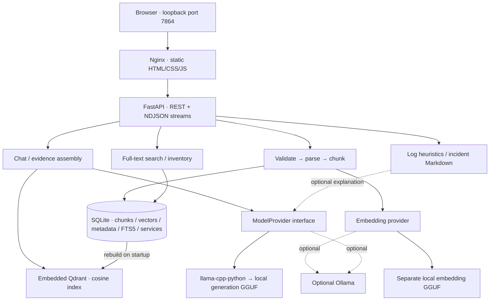

# Grimoire — local infrastructure assistant

**Self-hosted AI for understanding your homelab.** Search local runbooks, investigate supplied logs, and answer infrastructure questions with source evidence.

Grimoire combines local inference, document retrieval, log inspection, incident reports and a service inventory in one self-hosted workspace. It does not run infrastructure commands. Generation runs in-process through llama-cpp-python and a local GGUF model. Ollama is an optional compatibility provider; Grimoire no longer requires it. Embeddings use a separate local model.

**Local infrastructure → local data → retrieval / analysis → local inference → evidence → troubleshooting.**

**Stack:** Python · FastAPI · llama.cpp / GGUF · SQLite FTS5 · Qdrant · vanilla JavaScript · Docker.

[Run locally](#quick-start) · [Demo walkthrough](docs/demo.md) · [Architecture](docs/architecture.md) · [Security](docs/security.md) · [Verification results](docs/validation.md) · [Code map](#repository-structure)

**Status: v0.1.0 · single-user initial implementation.** Core workflows run with local Qwen 1.5B and MiniLM weights. A small synthetic suite measures reliability; see [results](docs/real-model-acceptance.md#reliability-milestone) and [limitations](#current-limitations). Compose still needs validation on a Docker host.

## Why Grimoire?

A homelab accumulates Compose files, service addresses, runbooks, troubleshooting notes and logs. Finding the right evidence during an incident becomes its own task. Grimoire puts that material within reach while keeping filenames, excerpts and line numbers attached to retrieved answers.

It is also useful without a model: search indexed text and service records, identify log error patterns, and export an incident outline. The original project vision is preserved in [this planning document](docs/vision-original.md); this README describes what is actually implemented.

## Implemented workflows

| Workflow | What works now |
| --- | --- |
| Assistant | Provider-based local chat with streaming, general/knowledge modes, bounded conversation context, stop control and provider errors |
| Knowledge | UTF-8 Markdown, TXT, JSON, YAML/YML and LOG uploads; syntax validation; structure-aware chunking; local embeddings; deduplication and deletion |
| Evidence | Qdrant cosine retrieval, configurable threshold, numbered excerpts with paths/chunks/line ranges; refusal when no evidence meets the threshold |
| Search | SQLite full-text search across text, filenames, source labels and services; type/service/source filters; no inference needed |
| Logs | Heuristic severity counts, repeated failures, evidence line numbers and optional model explanation |
| Incidents | Downloadable Markdown with observed window, symptoms, events, operator notes, hypotheses and uncertainty |
| Inventory | Persistent service records: hosts, VMs, containers, databases, proxies, monitoring and network devices; addresses, ports, URLs, dependencies and tags |
| Operations | Structured JSON logs, request IDs, liveness/readiness separation, persistent volume, non-root app containers and CI definitions |

## Quick start

Requires Docker Engine/Desktop with Compose v2. The supplied image builds a CPU llama-cpp-python runtime; CUDA is not required. Provide your own compatible GGUF files. Qwen2.5 3B Instruct GGUF is an example generation model, not a bundled or validated model recommendation. Use a separate pooled embedding GGUF with its required input conventions. Model licenses and hardware requirements depend on the files you choose.

```bash
git clone https://github.com/writchcraft/grimoire-ai.git
cd grimoire-ai
cp .env.example .env
mkdir -p models
# Explicitly place your generation model at models/chat.gguf
# and your embedding model at models/embed.gguf before starting.
docker compose up -d --build
```

Open [Grimoire](http://localhost:7864). Refresh status during loading. Missing or broken weights leave the application available in a degraded state. General chat only needs generation; uploads and knowledge retrieval need embeddings too. Startup never downloads weights. Model files/directories are ignored by Git and mounted read-only into Docker.

On PowerShell use `Copy-Item .env.example .env` and `New-Item -ItemType Directory -Force models`. Set `GRIMOIRE_MODELS_DIR` for another host directory. Compose model paths refer to `/models/...` inside the container. See [setup](docs/setup.md) for shell-based development, optional Ollama, CPU/GPU builds and reindexing existing documents.

### Try the fictional infrastructure

1. In **Knowledge**, upload `data/examples/monitoring.md`, `reverse-proxy.yaml` and `database.json`.
2. Ask “What port does Grafana use?”, “How is PostgreSQL configured?” or “How do I restart my reverse proxy?” in **Indexed knowledge** mode. Inspect the source excerpts.
3. Search for `3000` or `reverse-proxy.yaml`. Lexical search does not call a model. See the [demo checks](docs/demo.md) for negative questions and restart verification.
4. In **Logs & incidents**, load `data/examples/proxy-incident.log` and choose **Analyse logs**, initially without model explanation.
5. Add notes from `data/examples/incident-notes.txt`, create an incident, and download Markdown.
6. Add a fictional service in **Services**. Inventory is searchable; upload a runbook for inventory facts you want in knowledge chat.

Examples contain only documentation addresses and no real infrastructure details. The [full demo](docs/demo.md) lists expected evidence, duplicate/version behavior and explicit acceptance checks.

## Command-line companion

Install the backend into your activated Python 3.12+ environment with `pip install -e './backend'` (add `[native]` for local inference; see [setup](docs/setup.md)). The CLI shares application services and shell-based `GRIMOIRE_` configuration with the web app:

```bash
grimoire doctor
grimoire serve
grimoire status
grimoire knowledge ingest ./data/examples/
grimoire evaluate
grimoire evaluate --json --output .cache/evaluation.json
```

`serve` runs the UI/API on loopback port 7864. Other commands include `models list`, `models inspect`, explicit `models verify`, `knowledge search "grafana port"`, `logs analyse example.log`, `demo`, and `validate`. Diagnostics support `--json` and never download weights or install dependencies. See [CLI behavior and exit codes](docs/setup.md#command-line-interface).

## Interface

Current screenshots show the native-provider UI with no weights configured. Incident and service content is fictional demo data; no live integration or successful model inference is implied.



[Knowledge and upload](docs/screenshots/knowledge.png) · [Log evidence](docs/screenshots/logs.png) · [Incident report](docs/screenshots/incident.png) · [Service inventory](docs/screenshots/services.png)

## Architecture



Python 3.12+, FastAPI/Pydantic, llama-cpp-python, HTTPX, SQLite FTS5, Qdrant local mode, vanilla JavaScript modules and Nginx. No frontend build step, external fonts or CDNs are required.

SQLite is the durable source of truth, including embeddings. Qdrant holds an in-memory local vector index rebuilt at startup. This gives a single persistence boundary for a small single-process installation. PostgreSQL and a separate vector service are deferred until scale or multiple users justify them. Read the [architecture decisions](docs/architecture.md).

## Configuration

Compose reads `.env`; native development reads environment variables. All names below use the common `GRIMOIRE_` prefix, omitted in the table.

| Variable | Default | Purpose |
| --- | --- | --- |
| `PORT` | `7864` | Loopback host port for Compose and native development |
| `AI_PROVIDER` | `native` | Generation backend: `native` or `ollama` |
| `EMBEDDING_PROVIDER` | `native` | Independent embedding backend: `native` or `ollama` |
| `MODELS_DIR` | `./models` | Compose host directory mounted read-only at `/models` |
| `NATIVE_MODEL_PATH` | unset; Compose `/models/chat.gguf` | Generation GGUF |
| `NATIVE_EMBEDDING_MODEL_PATH` | unset; Compose `/models/embed.gguf` | Separate pooled embedding GGUF |
| `NATIVE_CONTEXT_SIZE` | `8192` | Generation context tokens (also Ollama `num_ctx`) |
| `NATIVE_EMBEDDING_CONTEXT_SIZE` | `2048` | Embedding context tokens; truncation disabled |
| `NATIVE_GPU_LAYERS` | `0` | CPU default; `-1` requests GPU offload with a compatible build |
| `NATIVE_THREADS` | unset | Binding chooses threads; optional positive integer |
| `NATIVE_CHAT_FORMAT` | unset | GGUF chat template; optional binding format override |
| `MAX_OUTPUT_TOKENS` | `2048` | Output limit; leave room in model context |
| `OLLAMA_URL` | `http://ollama:11434` in Compose | Model endpoint; native default `http://127.0.0.1:11434` |
| `MODEL` | `qwen2.5:3b` | Optional Ollama chat model |
| `EMBEDDING_MODEL` | `nomic-embed-text` | Embedding identifier; changes require deleting/re-ingesting documents |
| `DATA_DIR` | `/app/data` in Compose | SQLite directory; native default `data/runtime` |
| `MAX_UPLOAD_BYTES` | `2097152` | Per-file 2 MiB limit; configuration ceiling 10 MiB |
| `RETRIEVAL_THRESHOLD` | `0.45` | Minimum cosine similarity; tune against your corpus |
| `LOG_LEVEL` | `INFO` | Application log level |
| `CONTEXT_CHARS` | `12000` | Retrieved-context/general-history character budget |
| `REQUEST_TIMEOUT` | `120` | Ollama HTTP timeout; native calls cannot be force-interrupted |
| `ALLOWED_HOSTS` | `["localhost","127.0.0.1","[::1]"]` | JSON host allowlist |

Knowledge selection uses a task-specific 512-token limit; structured log interpretation uses 384. `MAX_OUTPUT_TOKENS` controls general chat. Incomplete native/Ollama outputs are detected and rejected; an oversized prompt can still exceed the context.

The last three settings need shell variables for native mode or explicit Compose environment overrides. Compose always mounts data at `/app/data`.

## API

| Method | Path | Purpose |
| --- | --- | --- |
| GET | `/health` | Liveness |
| GET | `/api/status` | Model availability and index counts |
| POST | `/api/chat` | General/knowledge chat, optional NDJSON stream |
| POST | `/api/documents/upload` | Multipart file and optional service label |
| POST | `/api/documents/ingest` | Supplied text, filename, source label and service |
| GET / DELETE | `/api/documents`, `/api/documents/{id}` | List metadata / remove document, chunks and vectors |
| GET | `/api/search?q=...` | Text/inventory search; optional `service`, `document_type`, `source`, `limit` |
| POST | `/api/logs/analyse` | Patterns and optional explanation |
| POST | `/api/incidents/summarise` | Markdown incident from logs/notes |
| GET / POST / DELETE | `/api/services`, `/api/services/{id}` | List/create inventory / delete by ID |

Backend schema: `/openapi.json`. Interactive API docs are disabled to avoid CDN dependencies. `source_path` is a metadata label, never a server filesystem read.

```bash
curl http://localhost:7864/api/documents/upload \
  -F 'file=@data/examples/monitoring.md' -F 'service=grafana'
curl http://localhost:7864/api/chat \
  -H 'Content-Type: application/json' \
  -d '{"message":"What port does Grafana use?","mode":"knowledge","stream":true}'
curl 'http://localhost:7864/api/search?q=3000&document_type=md'
```

Streams emit `sources`, `token`, then `done`. Knowledge responses are buffered until validation completes; general chat streams tokens. Failures emit `error` without `done`, potentially after HTTP 200. In knowledge mode, `grounded` means selected complete evidence lines passed source/excerpt checks, not that the evidence is true or relevant. `claims` maps excerpts to retrieved labels. `quality` distinguishes validated selections, insufficient evidence and rejected model output. General chat remains unvalidated.

## Repository structure

```text
backend/
  app/ai/           protocols, registry, native and Ollama adapters
  app/api/          REST handlers
  app/core/         configuration, logging, guards, errors
  app/ingestion/    validation, parsers, line-aware chunks, pipeline
  app/rag/          retrieval and evidence prompt assembly
  app/services/     storage.py (SQLite/Qdrant/FTS/inventory), log_analysis.py
  app/models.py     request and source schemas
  app/main.py       application factory and lifecycle
  tests/            API, parsing, retrieval, persistence, provider tests
frontend/
  src/              DOM interface, streaming decoder, styles
  public/           local branding
  tests/            stream decoding / errors
data/examples/      fictional runbooks, configs, logs and notes
docs/               architecture, setup, demo, security, validation
scripts/dev.py      same-origin native development server
docker-compose.yml local deployment and persistent volumes
```

## Development and tests

See [contribution guidelines](CONTRIBUTING.md) and the [Git workflow](docs/git-workflow.md)
for focused branches, commits and integration. Run `python scripts/check.py` with
the development environment activated for the local publication gate, including
tracked-file hygiene, Python checks and frontend checks. Docker and real-model
acceptance remain separate checks in the [release checklist](docs/release-checklist.md).

```bash
python -m venv .venv
source .venv/bin/activate   # PowerShell: .venv\Scripts\Activate.ps1
pip install -r backend/requirements.lock -e './backend[dev]'
python scripts/dev.py      # http://127.0.0.1:7864; run from repository root
```

For native inference install `pip install -r backend/requirements-native.lock -e './backend[native,dev]'`, then set GGUF paths in your shell. The development script does not load Compose's `.env`. The base install and tests need no native binding or model weights. See [setup](docs/setup.md).

```bash
python -m pytest backend/tests -q
python -m ruff check backend scripts
python -m ruff format --check backend scripts
npm run check --prefix frontend
npm test --prefix frontend
docker compose config --quiet
docker compose build
```

Tests use provider fakes, fake native bindings and HTTPX mock transports. They require no model weights, Docker daemon or internet. CI defines Python 3.12/3.13 checks, JavaScript checks and container builds. See [validation notes](docs/validation.md) for what has actually run.

## Security and privacy

Only the frontend is host-published, on loopback. There is no authentication in v0.1; do not expose it to a LAN or internet without an authenticated TLS gateway. Trusted Host validation and same-origin write checks reduce browser-origin attacks. Backend and Ollama ports stay private.

Uploads have byte limits, sanitized filenames, UTF-8/binary validation and safe parsing. There is no dynamic evaluation, shell or infrastructure execution. The UI renders untrusted content as text. No cloud AI or telemetry exporter is enabled by default.

Prompt injection remains a risk: source text is untrusted, models may ignore instructions, and similarity does not establish truth. Do not upload secrets. Embeddings and excerpts are sensitive too. See [the threat model](docs/security.md).

## Current limitations

- Real native CPU loading, generation, embeddings, RAG, CLI and browser workflows have executed with Qwen2.5 1.5B and MiniLM. [Measured acceptance results](docs/real-model-acceptance.md) document citation adherence and log-summary inaccuracies, plus process-level offline checks. Docker remains blocked because its CLI is unavailable. Ordinary tests remain weightless.
- Single process, single trusted operator, local-scale corpus. Qdrant rebuilds in RAM; do not run multiple backend workers against one directory.
- Use one backend worker. Native generation is serialized; cancellation waits for the current native call. CPU latency/RAM depend on model and context. GPU requires a compatible runtime build.
- Knowledge answers are extractive: source IDs and complete quoted lines are validated before display. Selection relevance, outdated documentation and misleading combinations still need review. Empty/below-threshold retrieval refuses deterministically.
- Chunking uses document structure and bounded long-line splits, not complete semantic/AST parsing. UTF-8 text only; no PDFs, images or compressed logs.
- Log severity/repetition are heuristics, not anomaly detection. Event output is capped at 80; the model sees up to 12 complete highlighted events within a 5,000-character JSON event budget. Interpretation uses a small validated symptom vocabulary and fixed cautious explanations. Time ranges follow input order, without timezone normalization.
- Inventory is searchable but not automatically embedded. No source watchers, ingestion jobs, inventory editing or durable conversations yet. Chat history lives in the tab.
- No authentication, multi-user access roles or Prometheus metrics endpoint. Resource controls and backup/restore need further operational validation.

## Roadmap

- [x] Milestone 1: chat, provider abstraction, UI, health/configuration/errors, Docker definitions
- [x] Milestone 2: ingestion, embeddings, local retrieval, citations, lexical search
- [x] Milestone 3: log evidence, optional explanation, incident Markdown
- [x] Milestone 4 initial scope: service inventory, UI polish, tests, request observability
- [x] Windows CPU real-model operational acceptance (see quality limitations in the validation record)
- [x] Labelled retrieval/evidence evaluation and deterministic output validation (see measured results)
- [ ] Next: address measured reliability gaps; Linux Compose and backup/restore rehearsal
- [ ] Later: indexing jobs, incremental reindex, inventory updates/RAG and authentication
- [ ] Future: Prometheus/Grafana, Docker/Proxmox, Home Assistant, Wazuh, alert summaries, read-only diagnostics, dependency maps, multiple providers and MCP

Future integrations are not implemented. [MIT license](LICENSE).
