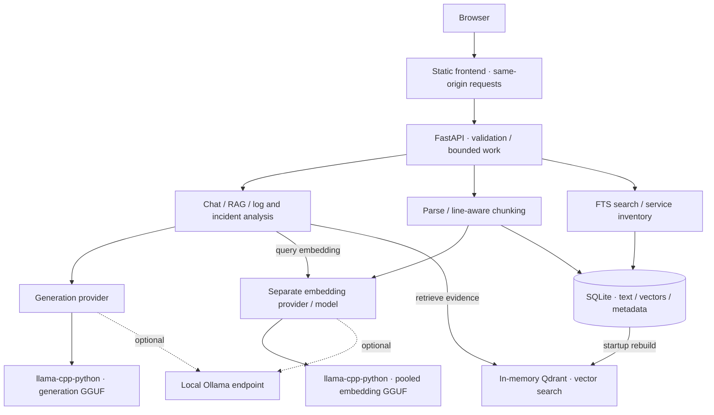

# Architecture and decisions

Grimoire v0.1 is an operator-driven local knowledge tool. It reasons over supplied documentation and log excerpts. It does not inspect running services or execute commands. `create_app(settings, provider, embeddings)` is the composition boundary: tests replace the provider without changing API logic.

## Request paths

Generation produces text; embeddings produce retrieval vectors. llama.cpp and Ollama are runtimes, not model weights. Qdrant ranks vectors; it does not generate answers. Logs/incidents extract deterministic evidence before optional generation. Inventory lives in SQLite and is searchable, but is not automatically included in RAG.

Native GGUF support keeps model loading and lifecycle within Grimoire, with explicit local files and no required model-server daemon. Ollama remains an optional adapter for operators who already manage models there. Neither runtime downloads weights on Grimoire's behalf.

- Chat → validation → bounded retrieval/context → provider → answer/stream + source disclosures.
- Upload → byte limit → sanitized basename → UTF-8 validation → syntax validation → line-aware chunks → batch embeddings → SQLite transaction + Qdrant index.
- Search → tokenized SQLite FTS5 query and SQL metadata filters; inventory search examines stored records. No model call.
- Logs → deterministic severity/repetition evidence → optional bounded explanation → JSON or Markdown.

Optional Ollama HTTPX calls are asynchronous. Native model loading, generation, stream iteration/cleanup and embeddings run on dedicated worker threads. Async endpoints offload parsing and persistence to worker threads. A lock serializes vector queries/mutations; SQLite connections are short-lived with foreign keys enabled. Two inference slots and one ingestion slot bound active work locally; these are not a distributed queue or internet-facing rate limit.

## ADR 001: SQLite instead of PostgreSQL

One operator and one process do not justify another database service. SQLite provides transactions, WAL, document/service persistence and full-text search. PostgreSQL becomes useful with concurrent writers, accounts or multi-process execution. The initial schema bootstrap is not a migration framework.

## ADR 002: Embedded Qdrant, durable SQLite embeddings

Qdrant local mode supplies cosine vector search without a separate daemon. SQLite stores chunks and vector arrays durably; an in-memory Qdrant collection is rebuilt on startup. This provides one authoritative backup boundary instead of two independently persisted stores.

Ingestion stages SQL changes, upserts vectors under the storage lock, then commits SQL. On failure, points are removed and SQL rolls back. A crash before commit leaves no durable document; restart reconstructs consistent index state. Deletion commits SQL before point cleanup. Every vector hit joins current SQL rows, so deleted text cannot be returned from stale points.

This trades RAM and startup time for straightforward local operations. Use exactly one backend worker. Scale via server-backed Qdrant, durable indexing jobs and reconciliation. An embedding-model identifier is persisted; changing it with indexed documents prevents startup. Dimensions are checked too. Native weights also use file metadata and a bounded content fingerprint (see below). The optional Ollama adapter cannot detect weight updates behind an unchanged server model name; pin versions and re-ingest deliberately.

## ADR 003: Provider protocol

`app/ai/base.py` defines separate generation (`ModelProvider`: chat, stream) and embedding (`EmbeddingProvider`: embed) protocols. Both expose startup, lightweight health/identity and close. `app/ai/registry.py` selects adapters independently from validated settings. API, RAG and analysis code have no Ollama-specific calls. RAG receives an embedding provider, and sends assembled evidence to the same generation provider used by general chat and logs/incidents.

Native inference is the default: Grimoire → NativeProvider → llama-cpp-python → local generation GGUF. A separate NativeEmbeddings instance loads a pooled embedding GGUF with `embedding=True`; it does not embed using the chat model. Both retain one loaded instance, use configurable context/threads/GPU layers and never download weights. Optional Ollama adapters retain `/api/chat`, `/api/embed` and tags-only readiness; embedding truncation is disabled and vectors are validated before storage.

Startup schedules native loads in the background. `not_configured`, `model_missing`, `loading`, `ready` and `failed` describe each subsystem independently. `/health` is liveness; `/api/status` includes `ai` and `embeddings` metadata (provider, backend, basename/model, state, reason and context where applicable). Overall readiness needs both models; general chat works with generation alone. Health never invokes generation or loads a model. Invalid providers/options fail settings validation; missing files/bindings and load failures leave the app degraded with safe public errors. Restart after repairing configuration/files; there is no hot reload.

Each native instance owns a single-thread executor and an async lock spanning a complete request or stream. All binding calls, including load/next/close, stay on that worker. Generation serializes across chat, RAG, log and incident requests; independent embeddings can run concurrently. Cancellation drains the active native call before releasing ownership; token evaluation or load cannot be forcibly interrupted. Stream disconnect cleanup closes its iterator. CPU work may continue until the current call finishes, shutdown waits for loading/inference, and no native hard timeout is promised. Two API inference slots and one ingestion slot remain; use one process/worker to avoid model duplication and storage races.

SQLite preserves the previous Ollama embedding identifier for compatibility. Native identity includes provider, identifier and model path; switching embedding provider/model/path with indexed documents refuses startup. Delete documents under the old configuration, then restart and re-ingest. Native identity also checks file size, nanosecond mtime, file identity and a bounded beginning/middle/end fingerprint. Normal same-path weight replacement invalidates populated indexes; deliberately preserving metadata and changing only unsampled bytes can evade this lightweight check. See [real acceptance](real-model-acceptance.md). Generation model changes do not invalidate embeddings. Parsing, SQLite/Qdrant persistence, source assembly and log heuristics are unchanged.

Native public errors/log events exclude exception strings, full paths and prompts. The binding uses `verbose=False`. A generation error (such as context overflow) returns an error without unloading an otherwise loaded model. Character budgets remain approximate; choose a compatible context and leave output room.

## ADR 004: Bounded evidence

Knowledge chat merges up to 48 vector candidates with bounded SQLite FTS5/BM25 candidates for the question and up to four deterministic clauses. A small explicit scorer combines cosine similarity, normalized token/identifier overlap, entity/attribute coverage, inherited headings, filename/service metadata and scope/history/instruction-text penalties. Lexical evidence can rescue a chunk below the cosine threshold. The top 12 deduplicated candidates feed a separate evidence selector; they are not concatenated directly.

The selector ranks each clause independently, covers recognized attributes, and may include previous/next Markdown chunks from the same heading section. Expansion is bounded to immediate siblings, a 4,000-character anchor/sibling pair and eight selected/expanded records. Near-duplicates with different normalized terms, exact values, negations or query identifiers survive. A soft source-diversity preference applies after two results only within a 0.15 score window; clearly stronger sources retain priority. Selected anchors appear in relevance order before supplemental siblings.

JSON evidence packets preserve exact source text and line ranges, with headings/service identities as separate metadata. Duplicate excerpts are removed and complete records must fit the character budget. Missing recognized attributes/entities after budgeting prevent generation. Selected model claims are checked again for recognized multipart attribute coverage before display; an incomplete selection returns insufficient evidence. These lexical checks are necessary signals, not proof of semantic sufficiency or a general question parser. Request-local labels retain source identity. Previous assistant claims are excluded; follow-up retrieval uses bounded prior-user context.

`grimoire knowledge search "query" --debug [--service NAME] [--json]` runs the same hybrid ranker without generation and reports scores/components, filters, identified needs and selected IDs. It now requires the configured embedding runtime. The browser's document explorer remains its existing lexical/filter API; supported QA uses hybrid search.

Knowledge generation selects complete evidence lines through typed JSON. Grimoire rejects unknown labels, invented excerpts, partial-line quotes (which could drop a negation), contradictory refusal/conclusions, empty evidence and extra fields. The application assembles text and citation cards only from validated selections, returning the selected source subset and a claim-to-label map. Knowledge streams are buffered before answer text is emitted. General chat remains unvalidated prose.

This establishes excerpt provenance, not semantic correctness. A model can select irrelevant, outdated or misleading lines. Combining individually correct lines need not resolve their scopes correctly. The evaluator reports rankings, required-evidence hit@1/3/5, context-budget misses and generation with oracle evidence separately. Character budgets approximate model context, not exact token counts.

Both generation adapters implement `chat_json` with constrained decoding and strict Pydantic validation. Native decoding omits string length/regex constraints that the bundled llama.cpp grammar cannot safely compile; Python enforces the full original contract. Output limits are task-specific: 512 knowledge, 384 log interpretation. General chat retains its configured limit. Native `finish_reason=length` and Ollama `done_reason=length` are failures, not successful answers. Evaluation records token/termination metadata without retaining private application prompts or answers.

## ADR 005: Line-preserving parsing

Chunks pack intact paragraphs, lists, fenced blocks and config/service groups where possible, retaining the 1,400-character target and 2,400-character hard bound. Markdown headings and TXT INI sections start new chunks; inherited heading paths are persisted separately from exact excerpts. YAML/JSON `services`/`containers` peer blocks are kept together below the hard limit; ordinary key/value groups remain intact. Timestamp/severity log entries retain continuation lines when bounded. Oversized units fall back to lines; oversized single lines use bounded fragments with their original line number. Syntax validation does not rewrite documents. This remains a lightweight text packer, not a complete AST chunker: unusually large config objects, deeply nested structures, exotic formatting and minified JSON can still split. YAML event parsing avoids object construction/alias expansion and rejects custom tags.

SQLite adds a default-empty `heading` column for existing indexes; existing vectors/text remain valid but do not gain new chunk boundaries/headings automatically. To apply the new packer to existing documents, deliberately delete/re-ingest them with the same embedding identity. A duplicate upload alone remains idempotent. No automatic model selection or index rewrite occurs.

## ADR 006: Static frontend

HTML/CSS and JavaScript modules cover the four workflows without a framework or build pipeline. Untrusted content uses DOM text nodes. Responses/Markdown are displayed as text; incidents can be downloaded. Nginx provides a same-origin proxy with stream buffering disabled. The native development script serves the same assets with the API.

## Future integration boundary

Add typed read-only evidence providers with explicit source/time metadata, timeouts and permissions. Add durable jobs before automatic ingestion and authentication before multiple users. Document-suggested commands must not become executable tools.

## References

- [Qdrant Python client local mode](https://github.com/qdrant/qdrant-client#local-mode)
- [llama-cpp-python API and build options](https://llama-cpp-python.readthedocs.io/en/latest/)
- [Ollama API specification](https://github.com/ollama/ollama/blob/main/docs/openapi.yaml)

## Structured log evidence and incidents

The application extracts line numbers, literal raw lines, heuristic severities, observed timestamps and repeated patterns. Named counters can be normalized for repetition; error codes, addresses and ports remain distinct. The model sees at most 12 whole events within a 5,000-character serialized event budget and bounded operator notes. `model_event_lines` discloses which observations reached generation.

The model selects typed symptom interpretations with supporting line references. Application-derived candidates reduce copying/counting errors. Validation rejects nonexistent references, unsupported symptom kinds, unmatched symptom text, restart claims without two separate restart lines, fabricated fields and numeric confidence. The renderer owns cautious descriptions (`possible`, `probable`, `insufficient evidence`) and read-only investigation suggestions. This narrow vocabulary sacrifices rich narrative detail for traceability. Other errors can return unknown.

Incident Markdown separates Confirmed, Probable and Unknown. Its relevant-event timeline is rendered only from extracted warning/error lines, never model text; notes remain labelled operator reports. It is a filtered input-order timeline, capped at 80, not a complete service history or verified root cause. Root cause and recovery remain unknown under this contract. No model-generated command is executed.
