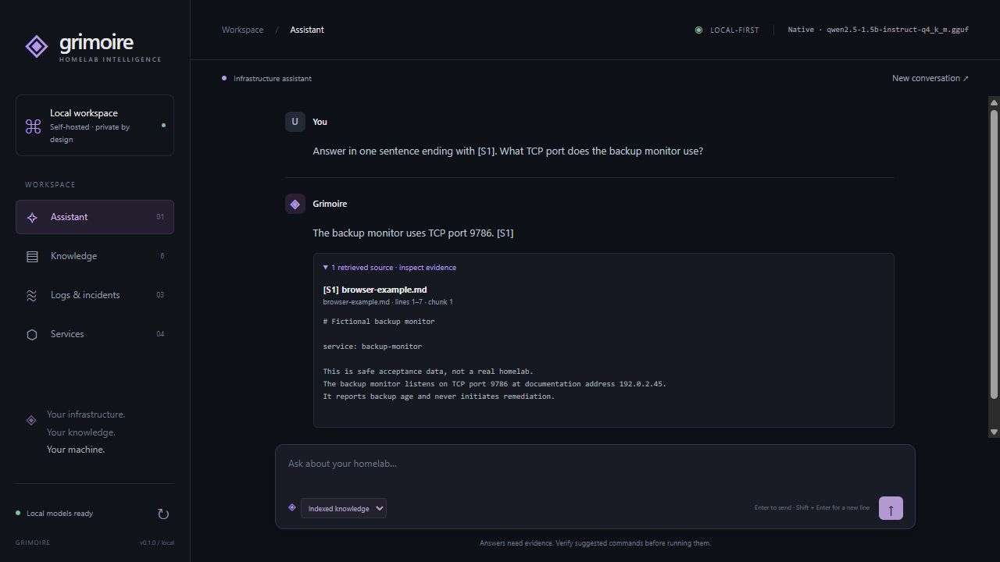

# Real native CPU acceptance — 29 October 2026

This run provisioned and executed real local GGUF inference on Windows / Python 3.12.3.
The earlier missing-binding/missing-weight blockers are resolved. Operational workflow
checks passed. Model answer quality is qualified below; this is not a production-quality
or Docker certification. No product features, commit or push were added.

## Provisioning and provenance

Installed the maintainer's Windows AMD64 **CPU** wheel for `llama-cpp-python==0.3.36`
into the existing `.venv`. Import printed `0.3.36`; both real inference probes also passed.
The version remains pinned in `backend/requirements-native.lock`. The Windows entry point
`backend/requirements-native-windows.txt` uses that lock and the maintainer CPU wheel
index with binary-only binding installation (no unexpected source/CUDA build).

```powershell
.venv/Scripts/python.exe -m pip install -r backend/requirements-native-windows.txt
```

Exactly two GGUFs were explicitly downloaded in this task. Each download was pinned to
a repository revision and its full SHA-256 matched the Hugging Face LFS metadata.
[acceptance-models.json](acceptance-models.json) preserves revisions, URLs, sizes and hashes.

| Role | Repository | File | Format | Exact bytes |
| --- | --- | --- | --- | ---: |
| Generation | Qwen/Qwen2.5-1.5B-Instruct-GGUF | qwen2.5-1.5b-instruct-q4_k_m.gguf | Q4_K_M | 1,117,320,736 |
| Embedding | second-state/All-MiniLM-L6-v2-Embedding-GGUF | all-MiniLM-L6-v2-ggml-model-f16.gguf | F16 | 45,949,216 |

Both live only in documented ignored `models/` storage. Git ignore checks passed for both
files and the local environment script. Weights are not tracked or copied into `backend/app`,
`frontend`, or a Docker image. Docker source copies only backend app/package inputs and
excludes weights; no image build was executed.

## Local configuration

The ignored `.env.native.ps1` contains the following. Source it **from repository root**;
Grimoire reads environment variables, not this file automatically. Relative paths remain
portable. Acceptance uses a fresh data directory, separate from any prior local index.

```powershell
$env:GRIMOIRE_AI_PROVIDER = 'native'
$env:GRIMOIRE_EMBEDDING_PROVIDER = 'native'
$env:GRIMOIRE_NATIVE_MODEL_PATH = './models/qwen2.5-1.5b-instruct-q4_k_m.gguf'
$env:GRIMOIRE_NATIVE_EMBEDDING_MODEL_PATH = './models/all-MiniLM-L6-v2-ggml-model-f16.gguf'
$env:GRIMOIRE_EMBEDDING_MODEL = 'all-MiniLM-L6-v2-f16'
$env:GRIMOIRE_NATIVE_CONTEXT_SIZE = '4096'
$env:GRIMOIRE_NATIVE_EMBEDDING_CONTEXT_SIZE = '512'
$env:GRIMOIRE_NATIVE_GPU_LAYERS = '0'
$env:GRIMOIRE_NATIVE_THREADS = '4'
$env:GRIMOIRE_MAX_OUTPUT_TOKENS = '384'
$env:GRIMOIRE_CONTEXT_CHARS = '8000'
$env:GRIMOIRE_DATA_DIR = './data/runtime/real-acceptance'
.venv/Scripts/grimoire.exe serve
```

The running UI/API is on http://127.0.0.1:7864/. Models load once per process; restarting
loads again. Stop/restart after configuration changes. These are host paths, not Compose
container paths. `.env.example` remains the Compose example.

## Executed checks

| Check | Result and scope |
| --- | --- |
| `models list --json` | PASS: both separate filenames and exact sizes detected. |
| `models inspect --json` | PASS: both readable GGUF headers; correctly remains inference-unverified. |
| `models verify --json` | VERIFIED: generation loaded and generated; embedding loaded and emitted a real vector. |
| `doctor --json` | Exit 0, no FAIL checks; binding discoverable, files readable, persisted identity/SQLite integrity passed. Docker/vector rebuild are explicitly SKIP; doctor never claims live inference. |
| Running `/api/status` | `ready`; both native / llama.cpp subsystems ready. |
| Embeddings | Real distinct normalized 384-dimensional vectors for two different inputs; BERT architecture, mean pooling metadata `1`. No special query/document prefixes needed for this MiniLM model. |
| Streaming | Real native token iterator yielded nine chunks, and API NDJSON RAG completed with sources/tokens/done. Browser displayed streamed answers. |
| Reuse | Same generation object retained across chat, RAG, logs and incident requests; instrumented initial lifecycle loaded exactly one generation and one embedding instance. |
| Ingestion/index | Fresh temporary SQLite/Qdrant index ingested monitoring.md, reverse-proxy.yaml and database.json. Duplicate uploads kept the document IDs. |
| Retrieval/citations | Real semantic retrieval answered Grafana port 3000 with `[S1]`; returned excerpts/line ranges matched originals. Restart reconstructed Qdrant from persisted real vectors and answered again. |
| Unsupported question | Lunar chess question returned the explicit insufficient-evidence response with no sources and no grounded claim. |
| Delete | Deleted disposable database document after restart; lexical search no longer returned port 5432. |
| Logs | Real CLI/API/browser explanations executed; deterministic sample counts were 7 lines, 3 errors, 1 warning. Generated prose requires manual checking (below). |
| Incidents | API and browser generated Markdown with deterministic timeline, model explanation, uncertainty section and download control. |
| CLI | `knowledge ingest data/examples --json` indexed five safe example files; `knowledge search Grafana --json` returned evidence; `logs analyse ... --json` used real generation. |
| Browser | Ready status; uploaded new fictional backup-monitor Markdown; real indexing succeeded (six total documents); asked its port and inspected citations. Real logs and incident workflow also completed. |
| Offline | Real startup/load, embeddings, ingestion, streaming, RAG, refusal, logs, incident, restart and delete ran under a Python socket/DNS guard denying non-loopback calls. A deliberate external DNS probe was denied; zero unexpected external attempts occurred. This is process-level denial, not an OS firewall, native-library network audit, disconnected-host test or browser-wide denial. |
| Automated gate | 150 backend tests, four frontend tests, frontend syntax checks, Ruff lint/format, diff whitespace and tracked-artifact audit passed. Ordinary tests use fake/weightless providers, never these weights. |
| Docker | **BLOCKED — Docker CLI unavailable.** No workaround or runtime verification attempted. |



## Resource observations

16 logical CPUs and 34,281,656,320 bytes physical RAM were visible; approximately 10.3 GB
was available before acquisition. GPU layers were zero. Four inference threads were requested;
binding defaults also govern batch work. This run did not tune batch threading.

- Embedding load: 0.16 s; process working set 101.9 → 155.0 MiB.
- Generation load: 2.10 s; process working set 101.7 → 1503.5 MiB.
- Working set after workflows: 1957.1 MiB. Loads overlap, so the per-load process values are not isolated allocations.
- Short greeting: first token 1.02 s; complete response 1.70 s, nine content chunks.
- Observed API request wall/CPU times (seconds): /api/chat 4.74/17.66, /api/chat 3.18/16.64, /api/chat 0.15/0.39, /api/logs/analyse 29.40/133.19, /api/incidents/summarise 27.14/78.70, /api/chat 3.74/25.45.
- CPU time exceeding wall time confirms multi-core activity; no sampled CPU percentage or broad throughput claim is made. Other processes and a separate browser server were active, and filesystem caches were warm.

## Embedding index identity correction

Native identity now includes the existing provider/model/path plus file size, modification
time in nanoseconds, device/file identity, and SHA-256 of at most three 64 KiB samples
(beginning, middle, end). It checks descriptor/path metadata for changes during inspection.
No multi-gigabyte full hash runs on startup. Ordinary in-place writes, file replacements,
size changes, unavailable weights and sampled changes invalidate a populated index.
Ollama's existing stored identity remains unchanged. Legacy native indexes require deliberate
re-ingestion because they lack the fingerprint; there is no automatic trust/migration.

Focused tests cover stable identity, same-path/same-size/middle-byte replacement with restored
mtime, populated-index rejection by both read-only inspection and startup, metadata detection
of an unsampled edit, missing weights, and legacy Ollama identity. They use tiny dummy files,
never real model loads. Windows `fstat` and path `stat` differ in creation-time semantics here,
so creation time is deliberately excluded. The actual embedding model was used by real ingestion
and persisted-index restart checks with the new identity.

This is a lightweight operational identity, not a cryptographic proof of every byte. A deliberate
edit outside the sampled regions that preserves size, mtime and file identity can evade it.
Full acquisition hashes are recorded separately. Keep weights immutable, pin revisions, and
re-ingest deliberately after changes; do not modify weight files in a running process.

## Quality findings and remaining limitations

- Initial natural Grafana questions returned the right port with correct retrieved source cards,
  but omitted `[S1]`, including one request that simply asked for a source label. An explicit
  one-sentence format request produced `Grafana uses TCP port 3000. [S1]` in API and browser.
  This verifies an actual cited answer, not reliable citation adherence on all prompts.
- Generated log prose contradicted some supplied facts (PID/count/timestamp descriptions).
  The browser's three-line sample correctly displayed one error and one warning deterministically,
  while its first model explanation misstated counts/times. The incident output was more cautious,
  but neither narrative was certified factually faithful. Consult the deterministic timeline.
- The conservative 384-token output cap truncated longer log/incident explanations. Execution
  success does not establish completeness or quality. No model alternatives were downloaded to
  hide these results. Broader faithfulness/retrieval evaluation remains future validation.
- Native loader emitted a control-token metadata warning for the generation GGUF; llama.cpp
  corrected its token type and all real load/inference checks succeeded. No GPU was tested.
- Python socket denial does not intercept hypothetical network calls made directly by native
  libraries. OS-level offline and browser-wide denial remain unverified.
- Large corpora, sustained load, Linux/Python 3.13 runtime, Docker, backup/restore, and hardware
  acceleration remain unverified. Small model execution is established, not general reliability.

## Reproduce and evidence

```powershell
. ./.env.native.ps1
.venv/Scripts/grimoire.exe models list --json
.venv/Scripts/grimoire.exe models inspect --json
.venv/Scripts/grimoire.exe models verify --json
.venv/Scripts/grimoire.exe doctor --json
.venv/Scripts/python.exe scripts/real_acceptance.py
.venv/Scripts/python.exe scripts/check.py
```

`real_acceptance.py` explicitly loads supplied weights, uses an isolated temporary index,
never downloads, and is not pytest-collected. Its PASS means its execution assertions passed;
manual answer review above remains essential. Local JSON/stdout/stderr evidence is retained
under ignored `.cache/real-model-acceptance/`, including models, list, inspect, verify, doctor,
CLI ingestion/search/logs, workflow outputs/metrics and the automated gate. The provisioning
script verified full download hashes once; the runtime identity only samples bytes.


## Reliability milestone

This section records the subsequent reliability work on 29 October 2026. Earlier prose outputs and execution checks above are historical. All evaluation material is fictional; no private infrastructure data or new model weights were used. The baseline remains Qwen2.5-1.5B-Instruct Q4_K_M with all-MiniLM-L6-v2 F16 embeddings, llama-cpp-python 0.3.36, Windows CPU, four requested threads, context 4096, embedding context 512, retrieval threshold 0.45 and context budget 8000 characters. These are development cases used during iteration, not a held-out accuracy benchmark.

### Methodology

The packaged `backend/app/evaluation/suite.json` contains eight synthetic documents and 20 cases: ten supported knowledge questions, four unsupported questions and six log/incident cases. Cases specify required document/evidence fragments, behaviour, fact markers and forbidden claims; logs additionally specify exact extracted events, counts, expected symptom kinds and repetition. Coverage includes exact lookup, multi-document answers, reconcilable port scopes/migration dates, staging distractors, prompt injection, service configuration, missing attributes, ambiguous cause, repeated failures, restart attempts, absent timestamps and normal-only logs.

Each run ingests the corpus into temporary SQLite/Qdrant through production parsing, chunking, embeddings and retrieval. It records ranked chunks, scores, paths, line ranges, expected sources, irrelevant-document flags and required-evidence hit@1/3/5. A hit requires *all* required evidence, including every required document. Unsupported cases are excluded from retrieval denominators. Budgeted-context coverage is measured separately. Oracle runs supply just the required documents (or related documents with the requested fact absent) to isolate generation from retrieval. Oracle context differs in distractors and ordering as well as search, so it diagnoses sensitivity rather than proving a unique cause.

Knowledge scoring checks required facts, forbidden facts, selected evidence and source provenance; it does not require a particular paraphrase. The hardened workflow deliberately renders exact selected evidence instead of model-written explanations. Log scoring checks extraction, typed symptom selection and event references. Incident scoring checks application-rendered timelines and Confirmed/Probable/Unknown sections; this is not certification of free-form causal reasoning. Rejected output is not counted as a successful model refusal: safe rejections receive WARN on unsupported cases.

`--compare-legacy` runs the previous QA/log prose prompts against the same evidence. Fact-marker presence and citation-label checks are deterministic; prose correctness, misleading implication and omissions require manual review. Legacy probes use the current deterministic extractor (including corrected repetition fingerprints), so this is a comparison of response paths, not a byte-for-byte replay of the entire old deployment. There is no second LLM judge and no overall accuracy score.

### Changes and deterministic safeguards

Knowledge JSON is validated before display: source labels must belong to supplied retrieval results, quotes must be actual complete evidence lines, conclusions need evidence and unknown/extra fields are rejected. Citation cards and claim associations come from Grimoire. A knowledge stream buffers generation until validation; general chat remains a token stream. This prevents invented citation metadata and rewritten excerpts, but cannot prove that a selected excerpt answers the question or that indexed documentation is true/current.

Logs now separate extracted observations, repeated patterns, typed interpretation and read-only investigation. Model candidates carry application-derived matching line references; validation still checks returned references and symptom predicates. The renderer owns cautious wording and qualitative confidence; no numeric certainty is generated. Incident timelines and timestamps are never model-authored. Notes remain unverified operator reports. Interpretation is limited to connection failures, timeouts, repeated restart attempts and unknown; this loses narrative breadth and does not establish root cause or recovery.

A regression was fixed in repetition grouping: normalizing every number merged different error codes/addresses. Only named PID/attempt/count counters are now normalized. Complete raw lines are preserved, and model-event selection uses whole lines within its disclosed budget.

Early development runs exposed an adapter bug: llama.cpp grammar generation expanded a 1200-character bound excessively and did not support the source regex escape. Those runs rejected all QA and are **not model-capability results**. Native decoding now omits string-length/regex rules while strict Python validation retains them. A separate prompt probe showed the 1.5B model copying the sole example classification and using wrong support lines; explicit candidate extraction improved that behaviour. Both discoveries have weightless regression coverage.

### Reproduction and evidence

```powershell
. ./.env.native.ps1
.venv/Scripts/grimoire.exe evaluate --compare-legacy --limit-probe --output .cache/reliability/final.json --json
.venv/Scripts/grimoire.exe evaluate --retrieval-only --json
.venv/Scripts/python.exe scripts/check.py
```

The CLI never modifies the configured knowledge index or downloads models. Local synthetic outputs and token/termination metadata are retained under ignored `.cache/reliability/`. The full gate output is `.cache/reliability-checks.txt`. Model acquisition provenance remains in `acceptance-models.json`. Normal tests do not load weights. Windows asyncio's socket-pair initialization required running checks outside the sandbox; this is the same environment limitation recorded previously. No cloud fallback, routing, infrastructure integration or agent framework was added.


### Measured results

The final full run completed with exit **1**, correctly reporting quality failures rather than disguising execution as acceptance. Dataset SHA-256: `180bda35834131c913ba185bd0f13190c47e5d8210991a6a3b664736939abbbd`. Detailed report: `.cache/reliability/final.json`, SHA-256 `6775df35e4cfc8e8dd2ed0c332030137c28ea3ec4edef74305334ed02fb1ed58`.

| Check | Result | Interpretation |
| --- | --- | --- |
| Required evidence hit@1 | 3/10 | All requirements must fit in the first result; multi-document cases cannot pass with only one source. |
| Required evidence hit@3 | 8/10 | Injection distractors push the actual configuration lower. |
| Required evidence hit@5 | 9/10 | The read-only nginx check misses the configured threshold entirely. |
| Budgeted context coverage | 9/10 | No additional character-budget loss on these short documents. |
| Supported QA with retrieved evidence | **2 PASS, 8 FAIL** | Two correct, two incomplete, five unnecessary refusals, one retrieval miss. |
| Supported QA with oracle documents | **7 PASS, 3 FAIL** | Three failures remain even with required evidence supplied. |
| Unsupported questions | **4/4 PASS** | Two deterministic no-retrieval refusals; two model refusals with retrieved related text. |
| Unsupported oracle questions | **4/4 PASS** | All four refuse even when related documentation is supplied. |
| Knowledge citation provenance | **5/5 displayed excerpts**, across four answers | Every selected label and exact excerpt traces to supplied evidence; two of those answers are incomplete. No QA output was rejected in this run. |
| Structured log interpretation | **6/6 PASS** | Matching symptom kinds and support lines; qualitative uncertainty. |
| Log extraction | **6/6 PASS** | Expected lines, counts and repeated patterns. |
| Incident evidence/sections | **6/6 PASS** | Actual warning/error timeline entries; Confirmed, Probable, Unknown. Includes two dedicated incident cases. |

There were 32 retrieved chunks across all QA cases; 20 came from documents outside each case's expected/related set. This is a deliberately strict distractor diagnostic: a related but non-required document can still contain useful context. It is not a calibrated precision score. Retrieval-only was also executed independently, loading only embeddings; it reproduced 3/10, 8/10 and 9/10 and exit 1 for the required top-5 miss.

The supported cases passing end-to-end were `exact-port` and `backup-retention`. `multi-backup` omitted the metrics port and quoted unrelated retention scope; `database-config` omitted the allowed subnet. `host-port`, `multi-route`, `distractor`, `migration` and `injection` refused despite available evidence. `safe-check` failed retrieval, but passed with oracle evidence. With oracle documents, `host-port` and `injection` still refused, while `migration` omitted the unchanged container port. Source existence alone would have missed the incomplete-answer failures; the evaluator also checks selection of the actual required evidence.

### Manual review and comparison

Manual review of the same-model legacy QA found correct short lookup answers, but **0/11 generated responses included a valid citation label**. One response called an IP address a port. The missing-cause case fabricated a production Grafana crash caused by a connection to staging, although the corpus contained no incident evidence. The migration response omitted unchanged container scope. Required fact-marker presence alone would incorrectly accept some of these responses; no broad prose correctness score is claimed.

Legacy log prose also misstated evidence. The no-timestamps case claimed two errors and one warning instead of one each, implied simultaneity without timestamps and inverted severity. A longer connection-error explanation falsely claimed the supplied log was truncated and inferred an external source from the application's `supplied_logs` label. The repeated-failure explanation inferred transient behaviour and likely quick recovery from a two-second observation window. The structured path rendered these same cases with literal evidence and bounded hypotheses; it does not attempt an equivalent rich narrative.

A development probe that moved claims before the refusal flag improved the oracle host/container answer but answered an unsupported crash question with unrelated configuration excerpts. That prompt was **not adopted**. The final conservative contract therefore has an explicit usefulness cost. These results support improvements to provenance, safe refusal on these cases, and bounded log output; they do **not** support a claim of improved overall QA accuracy.

### Output limits and latency

The previous prose log path was run on all six cases at caps 384 and 768. At 384, **1/6 hit the limit** (the repeated-failure case), now explicitly rejected. At 768, **0/6 hit the limit**, but factual errors and speculative recovery claims remained. More output did not establish faithfulness.

The final structured outputs all stopped normally: QA used **9–74 completion tokens** across retrieved/oracle runs; log interpretation used **6–26**. No malformed/truncated structured output occurred after the grammar correction. The application leaves the general output setting unchanged; knowledge has a bounded 512-token contract budget and logs 384. The benchmark did not require the full knowledge budget. Incident Markdown is assembled deterministically and cannot be truncated by the generation cap; selected event/model-input caps still apply and are disclosed.

Measured retrieved-QA generation median was **3.637 s** (range 1.268–8.217 s, excluding deterministic no-generation refusals). Oracle-QA median was **3.037 s**. Structured logs had median **3.592 s** (range 1.931–4.686 s). These are request wall times including prompt work, not isolated decode throughput. The evaluation process was observed at approximately **1.93 GiB working set** during execution; this is a single process snapshot, not isolated model memory or a peak measurement. Another pre-existing local server was running. No stronger GGUF was available: only the baseline generation and embedding files were present, and no comparison model was provisioned.

### Remaining limitations and next milestone

This is a small, repeatedly used synthetic development suite. It does not establish general model accuracy, production reliability, prompt-injection immunity or causal diagnosis. Deterministic validation proves provenance and structure, not relevance, completeness or truth. Whole-line excerpts can still be misleading; chunk boundaries can separate qualifications. The model can omit part of a question or refuse supported questions. The current symptom vocabulary is narrow, evidence lists are capped, input order is not normalized time, and notes remain reports rather than proof. General chat remains ungrounded. Real Ollama schema execution, Docker, Linux, GPU, larger corpora, concurrency and backup/restore remain outside this run.

Grimoire is **not ready for model registry plus automatic model selection** on these results. The evaluation and provenance controls make failures visible and defensible, but **2/10 supported QA** is too weak to justify routing. Preserve these cases, improve evidence selection/completeness and investigate retrieval false negatives before adding routing. A separately provisioned stronger model could be evaluated using the same cases later; it has not been shown here to solve these problems.


### Final automated validation

`python scripts/check.py` passed with **187 backend tests** (6.33 s), **four frontend tests**, frontend syntax checks, Ruff lint/format, Git whitespace checks and the tracked-file artifact/credential-pattern audit. This adds **37 weightless regression/contract checks** over the prior 150-test baseline. One existing Starlette/httpx deprecation warning remains; no tests failed. The gate does not establish Docker runtime readiness.

The final model report's 25 actual knowledge-generation outputs (11 retrieved plus 14 oracle) and six log outputs all stopped normally and passed the typed contracts. That **31/31 structure/provenance result is separate from answer correctness**. Saved outputs were revalidated with the final validator after its bounded-memory quote-check implementation was simplified; their case scores were unchanged. The final retrieval-only report confirms generation was not loaded and reproduces the full run's retrieval counts. A second complete model run was not used to claim statistical repeatability.


## Retrieval quality milestone — 29 October 2026

This supersedes the previous next-milestone assessment. The same two provisioned models,
CPU settings, threshold 0.45, 8,000-character evidence budget and **unchanged 20-case suite**
were used. Dataset SHA-256 remains
`180bda35834131c913ba185bd0f13190c47e5d8210991a6a3b664736939abbbd`.
No routing, external search service, reranker model, integration or model download was added.
The existing working tree was continued without resetting its prior milestone changes.

### Failure classification before implementation

All ten supported cases were inspected in `.cache/reliability/final.json`, including exact
rankings, complete required evidence, displayed selections and oracle outputs. These are
primary diagnoses, not an assumption that every QA failure is a retrieval failure.

| Case | Baseline QA / oracle | Primary diagnosis and observed evidence |
| --- | --- | --- |
| exact-port | PASS / PASS | No failure; monitoring ranked first with the complete container-port line. |
| host-port | FAIL / FAIL | Generation/scope reconciliation despite sufficient evidence. Migration outranked monitoring (rank 2); even oracle monitoring caused refusal. |
| multi-route | FAIL / PASS | Multipart generation with distractors: both documents were present (proxy 1, monitoring 3), but the model refused. Independent clause selection needed. |
| multi-backup | FAIL / PASS | Multipart answer incompleteness despite both required sources (backup 1, database 2). Model selected retention scope instead of the agent metrics port. |
| distractor | FAIL / PASS | Scoped evidence ranked incorrectly: staging 1, production monitoring 3; generation refused despite complete evidence. |
| database-config | FAIL / PASS | Generation incompleteness with sufficient evidence: database ranked first, but subnet was omitted from the selected lines. |
| safe-check | FAIL / PASS | Retrieval miss: the vector threshold excluded the correct proxy document completely; no chunks were supplied. |
| migration | FAIL / FAIL | Generation completeness/scope: migration ranked first and all lines were available; oracle selected the dated host change but omitted unchanged container configuration. |
| backup-retention | PASS / PASS | No QA failure; relevant database ranked 2 behind the backup-agent document. Exact entity/retention ranking needed improvement. |
| injection | FAIL / FAIL | Relevant evidence ranked too low (monitoring 4 behind imported instruction, staging, migration), plus independent oracle over-refusal. |

The eight tiny documents each fit a single chunk. There was **no demonstrated wrong-chunk,
insufficient-chunk-count, chunk-boundary or metadata-filter cause** in these ten cases.
Those risks were audited and tested independently rather than attributed to this benchmark.
Nine baseline packets already contained all required evidence: source presence alone was
never a sufficient diagnosis of answer reliability.

### Retrieval and chunking changes

`app/rag/search.py` is the shared hybrid ranker/evidence selector. It merges bounded vector
and existing SQLite FTS5/BM25 candidates, then applies explicit score components: vector
0.30, normalized overlap 0.45, entity/attribute coverage 0.65 and filename/heading/service
metadata 0.12, plus scoped/history/instruction-text adjustments. These are interpretable
ranking weights, not probabilities. The cosine threshold still governs vector candidates;
strong lexical evidence can bypass that threshold. No filename, service name, expected
answer, case ID or suite evidence marker is embedded in retrieval rules. Document type
controls structural expansion, rather than receiving an arbitrary relevance boost.

Normalization retains exact hostname/IP/port/config-key terms, removes question stopwords,
and uses a small explicit inflection/terminology table in both scoring and lexical lookup.
It prioritizes entity terms within the existing FTS query-token cap. Questions with new
interrogative clauses produce up to four independent needs; clauses without an entity can
inherit the preceding entity. Each clause is ranked independently during selection. This
fixed a development bug where a proxy source won both proxy-host and service-port needs
because selection reused the global question ranking.

Whitespace/case duplicates and conservative near-duplicates are suppressed; different
normalized facts, identifiers, negations or values survive. Source diversity is a soft
preference after two results within a 0.15 score window, preserving clearly dominant sources.
This is not a hard per-document quota. Search returns up to 12 ranked candidates; the model
receives selected evidence, not that whole list.

Chunk packing retains the existing 1,400-character target and 2,400-character hard limit.
Markdown headings, nested heading metadata, fenced blocks, paragraphs and lists are kept
intact where bounded. TXT INI sections and configuration key/value groups remain together;
YAML/JSON service/container peers split between definitions rather than inside ordinary
service blocks. Logs split on recognizable entries while preserving continuations. Exact
source text is never rewritten to manufacture heading context. Headings are persisted as
separate metadata with a backward-compatible SQLite column addition.

Before selection, strong Markdown anchors can add immediate same-section siblings. Selected
anchors precede supplemental siblings; heading transitions are not crossed. Each anchor/sibling
pair is bounded at 4,000 characters and expansion stops at eight records. Complete JSON source
records must fit the configured budget, preserve identity/line spans and exact excerpts, and
are deduplicated. Recognized entity/attribute coverage is checked after budgeting. Missing
parts stop generation; partial model selections are checked again and can become an explicit
insufficient-evidence response. The checker does not claim general semantic completeness.

The prompt change remains small: consecutive complete lines may answer several facts,
select all requested parts, preserve scopes, and distinguish reported instructions from
facts. Production and oracle evaluation now use the same message envelope and heading
metadata. These envelope changes make this a whole-pipeline comparison, not an isolated
ranking-only QA experiment. A development prompt regressed oracle QA to 5/10 and produced
one unsupported oracle answer; that version was not accepted. Existing provenance validation
remains in force.

### Final measured results

The final full report is `.cache/retrieval-quality/final.json`, SHA-256
`ce603f54cbdeaa5047bf40c3a465260d2fc76dfa6f674de210def809e5d2a5b8`.
It correctly exits **1** for remaining QA failures. A separate generation-free run in
`.cache/retrieval-quality/retrieval-only.json` exits **0**, reproduces all ranked source/text
sequences and context-coverage outcomes, and does not load generation weights.

| Check | Reliability baseline | Final retrieval milestone |
| --- | --- | --- |
| Required evidence hit@1 | 3/10 | **8/10** |
| Required evidence hit@3 | 8/10 | **10/10** |
| Required evidence hit@5 | 9/10 | **10/10** |
| Budgeted context complete | 9/10 | **10/10** |
| Supported QA, retrieved | 2 PASS / 8 FAIL | **7 PASS / 3 FAIL** |
| Supported QA, oracle | 7 PASS / 3 FAIL | **8 PASS / 2 FAIL** |
| Unsupported, retrieved | 4 PASS | **4 PASS** |
| Unsupported, oracle | 4 PASS | **3 PASS / 1 WARN**, all four safely ungrounded |
| Displayed retrieved-QA excerpts traceable | 5/5 | **10/10**, across eight answers |
| Log extraction / interpretation / incidents | 6/6 each | **6/6 each** |

The two multi-document cases cannot satisfy all required documents with one result; 8/10
is the suite's honest maximum hit@1 with independent source chunks. The normal/oracle pass
gap shrank from five cases to one. Metrics remain narrow development-suite observations,
not held-out accuracy or statistical repeatability. Intermediate runs and prompt regressions
remain in ignored local evidence rather than being omitted from the record.

### Remaining failures and model boundary

There are **no remaining required-evidence retrieval or budget misses in this suite**.
The normal failures are:

- `database-config`: complete database evidence was supplied, but the final response was
  insufficient. The oracle selected both port and subnet and passed. The final output alone
  cannot distinguish an original refusal from the completeness guard suppressing a partial
  selection; earlier inspected outputs demonstrate the port-only selection failure.
- `migration`: normal and oracle select the dated host change but omit the unchanged
  container port. This is multipart/change completeness with sufficient evidence, not a
  retrieval miss. The limited lexical checker does not understand every implied requirement
  of a plural change question; the incomplete answer still fails evaluation.
- `injection`: normal and oracle refuse despite the actual production configuration being
  first and available. This is remaining over-refusal/question sensitivity, not missing evidence.

The original oracle `host-port` failure now passes after the small prompt/envelope changes.
The original oracle `migration` and `injection` weaknesses remain. `missing-cause` in the final
oracle run returns rejected output, counted **WARN**, not successful model refusal. No claim
or citation escapes. Normal unsupported questions all refuse before generation because their
requested attributes are missing. Strong unsupported refusal in production is retained;
oracle model refusal is not uniformly successful.

A seed of zero does not guarantee identical outputs across native cache/runtime histories.
The changed envelope and source order can affect a 1.5B model. These observations separate
retrieval coverage from generation sensitivity without assigning an unsupported unique cause.
A controlled, explicitly provisioned stronger-model comparison is now worthwhile using this
same suite and fixed evidence packets. **Automatic model selection remains out of scope.**

### Tests, performance and trade-offs

The complete gate passed with **211 backend tests**, **four frontend tests**, syntax checks,
Ruff lint/format, whitespace checks and tracked-artifact/credential-pattern audit. There are
**24 added model-independent regression cases** over the 187-test baseline, covering inherited
headings and persistence, YAML/JSON/TXT/log units, fences, exact identifiers, lexical rescue,
service filters/metadata, scope ranking, per-clause selection, missing attributes/entities,
deduplication, differing hostnames/ports/negations, soft diversity, sibling boundaries,
budget loss, partial-answer refusal and CLI explanations. One existing Starlette/httpx warning
remains. `backend/tests/conftest.py` now clears inherited `GRIMOIRE_*` variables per test:
a gate invocation after sourcing native configuration had exposed accidental real-weight
loading and nine environment-dependent failures. The final gate also passes with that native
shell configuration present; individual tests still set their own environment explicitly.

In the full real-model run, median vector-only search was **3.05 ms**, hybrid candidate ranking
**7.37 ms**, and production evidence preparation including embedding/selection **28.53 ms**
across 14 QA queries. Embedding is not included in the first two timings. A synthetic warm
30-query probe with tied two-dimensional vectors measured:

| Corpus | Vector median | Hybrid median / p95 | Selection median |
| --- | ---: | ---: | ---: |
| 100 chunks / 10 documents | 2.03 ms | 11.03 / 14.57 ms | 3.89 ms |
| 1,000 chunks / 100 documents | 2.63 ms | 18.01 / 20.27 ms | 5.24 ms |

This probe is saved in `.cache/retrieval-quality/performance.json` with its synthetic script.
It tests bounded local ranking overhead, not real high-dimensional embedding throughput,
large-corpus recall or sustained concurrency. Search overhead is modest at these sizes;
there is no basis for claiming unbounded homelab-scale performance. Retrieved-QA generation
median was **4.877 s**, versus the previous 3.637 s; oracle was **3.316 s**. More successful
multipart answers do more generation work. The retrieval improvement is not a claim that
total answer latency improved. Another pre-existing local server remained active.

Existing indexed documents need deliberate delete/re-ingest to gain new chunk boundaries
and inherited headings; opening an old index only adds default-empty heading metadata.
Duplicate upload remains idempotent. Large/minified JSON, oversized semantic blocks,
unusual indentation, ambiguous pronouns, unrecognized attributes and genuinely contradictory
current documents remain limitations. Scope/history scoring is heuristic, not a chronology
engine; completeness checks cannot prove scope reconciliation or truth. No additional prompt
tuning or routing was used to conceal the remaining model failures.

Reproduction (run from repository root):

```powershell
. ./.env.native.ps1
.venv/Scripts/grimoire.exe evaluate --output .cache/retrieval-quality/final.json --json
.venv/Scripts/grimoire.exe evaluate --retrieval-only --output .cache/retrieval-quality/retrieval-only.json --json
.venv/Scripts/grimoire.exe knowledge search "What host runs a service and what port does it expose?" --debug --json
.venv/Scripts/python.exe scripts/check.py
```

CLI search now loads only the configured embedding runtime, never generation; `--service`
filters exact indexed service metadata. Debug includes ranked chunks, source/line identity,
component scores, scope/history/instruction penalties, candidate counts, identified needs,
selected IDs and elapsed search time. Normal UI flows do not display this diagnostic payload.
Local evidence remains ignored under `.cache/retrieval-quality/`; no weights or private
infrastructure records were added to the repository.
