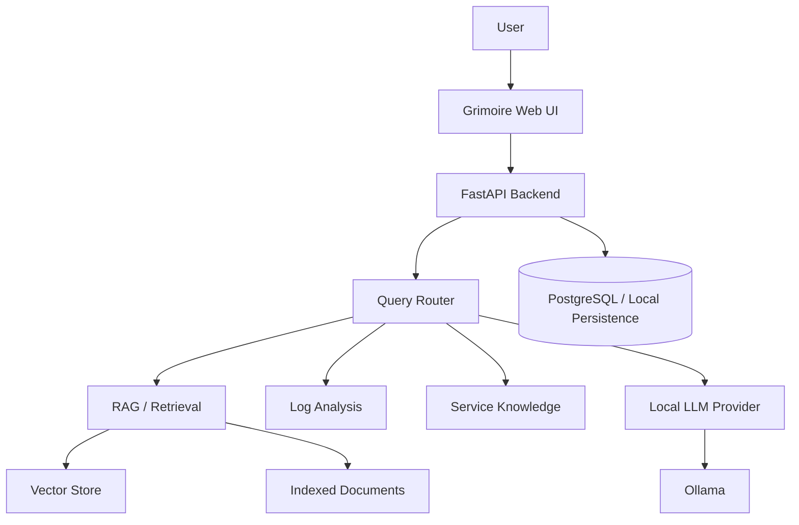

# Grimoire AI

> A self-hosted local AI assistant for understanding, searching, and troubleshooting a homelab.

**Status:** In development

Grimoire AI is a local-first infrastructure assistant designed to make homelab documentation, logs, and service information easier to query and understand.

Rather than being a simple chat interface for a local LLM, Grimoire is intended to combine **local inference, retrieval-augmented generation (RAG), document search, log analysis, and incident summarisation** into one practical tool for homelab operations.

---

## Why I Built This

Homelabs quickly accumulate:

- configuration files
- Markdown documentation
- Docker Compose files
- troubleshooting notes
- application logs
- system logs
- service addresses and ports
- monitoring information

Finding the right information during troubleshooting often means manually searching across several different sources.

Grimoire AI aims to provide one local interface for asking questions such as:

- *What port is Grafana exposed on?*
- *How is PostgreSQL configured?*
- *What does this Docker error mean?*
- *Why did this service stop working?*
- *Which log entries are most relevant to this incident?*
- *How do I restart this service according to my own documentation?*

The goal is not to replace normal administration tools. It is to make existing infrastructure knowledge easier to access and reason about.

---

## Project Goals

Grimoire is being built to demonstrate practical experience with:

- Python
- FastAPI
- Docker
- Linux
- local LLMs
- Ollama
- REST APIs
- RAG
- embeddings
- vector search
- PostgreSQL where appropriate
- logging and observability
- infrastructure troubleshooting
- testing
- secure local-first application design

---

## Planned Features

### Local AI Chat

A chat interface backed by a locally hosted model through Ollama.

Planned capabilities include:

- configurable model selection
- configurable Ollama endpoint
- streaming responses
- graceful handling when the model is unavailable
- provider abstraction to avoid tightly coupling the application to one backend

### Knowledge Ingestion

Grimoire will ingest homelab documentation and configuration files such as:

- Markdown
- plain text
- JSON
- YAML
- logs

Documents will be parsed, chunked, embedded, and indexed with useful metadata.

### RAG Question Answering

Questions will be answered using retrieved local context rather than relying only on model memory.

Grimoire should:

1. search indexed knowledge
2. retrieve relevant context
3. pass that context to the model
4. generate an answer
5. show the sources used

When the available evidence is insufficient, the assistant should say so rather than inventing an answer.

### Log Analysis

Planned support includes:

- Linux system logs
- SSH/authentication logs
- Docker logs
- nginx logs
- application logs

The assistant will help:

- identify errors and warnings
- detect repeated failures
- summarise relevant events
- explain technical messages
- suggest investigation steps
- separate evidence from hypothesis

### Incident Summaries

Grimoire will be able to turn logs and notes into a structured incident summary containing:

- incident title
- time range
- affected service
- symptoms
- relevant events
- probable cause
- uncertainty
- troubleshooting performed
- suggested remediation
- timeline

### Infrastructure Knowledge

The project is designed to support structured information about:

- servers
- VMs
- containers
- databases
- reverse proxies
- monitoring services
- network devices

---

## Architecture



---

## Planned Technology Stack

| Area | Technology |
|---|---|
| Backend | Python, FastAPI, Pydantic |
| Local AI | Ollama |
| RAG | Local embeddings + vector store |
| Vector storage | ChromaDB or Qdrant |
| Relational storage | PostgreSQL where useful |
| Frontend | Web-based chat UI |
| Deployment | Docker Compose |
| Testing | Pytest |
| Observability | Structured logs, health checks, optional metrics |

---

## Example Workflow

```text
Homelab Documentation / Logs
            ↓
        Ingestion
            ↓
      Parsing / Chunking
            ↓
        Embeddings
            ↓
        Vector Store
            ↓
User Question → Retrieval → Local LLM
            ↓
 Answer + Supporting Sources
```

---

## Planned API

Potential endpoints include:

```text
GET    /health
POST   /api/chat
POST   /api/documents/upload
POST   /api/documents/ingest
GET    /api/documents
DELETE /api/documents/{id}
GET    /api/search
POST   /api/logs/analyse
POST   /api/incidents/summarise
GET    /api/services
POST   /api/services
```

The final API will remain intentionally small and focused on useful functionality.

---

## Local-First Design

Grimoire is intended to run locally.

Design goals include:

- no cloud AI dependency by default
- no telemetry by default
- no committed secrets
- local model inference
- local document indexing
- safe file handling
- no autonomous command execution

Indexed documents must be treated as **untrusted input**.

Grimoire may recommend commands, but the initial project will not automatically execute infrastructure commands.

---

## Project Structure

Planned structure:

```text
grimoire-ai/
├── backend/
│   ├── app/
│   │   ├── api/
│   │   ├── core/
│   │   ├── models/
│   │   ├── services/
│   │   ├── rag/
│   │   ├── ingestion/
│   │   └── main.py
│   ├── tests/
│   └── Dockerfile
├── frontend/
│   ├── src/
│   └── Dockerfile
├── data/
│   └── examples/
├── docs/
│   ├── architecture.md
│   ├── setup.md
│   └── security.md
├── docker-compose.yml
├── .env.example
└── README.md
```

The structure may evolve as the application develops.

---

## Development Roadmap

### Milestone 1 — Local Chat

- [ ] FastAPI backend
- [ ] Ollama integration
- [ ] configurable model and endpoint
- [ ] basic web chat
- [ ] Docker support
- [ ] health endpoint
- [ ] error handling

### Milestone 2 — Knowledge & RAG

- [ ] document ingestion
- [ ] structured parsing
- [ ] embeddings
- [ ] vector storage
- [ ] retrieval
- [ ] source citations

### Milestone 3 — Logs & Incidents

- [ ] log ingestion
- [ ] error/warning identification
- [ ] log summarisation
- [ ] incident summaries
- [ ] evidence-aware troubleshooting

### Milestone 4 — Infrastructure Knowledge

- [ ] service inventory
- [ ] search
- [ ] UI polish
- [ ] improved testing
- [ ] application observability

### Future Integrations

Potential later integrations include:

- Prometheus
- Grafana
- Docker API
- Proxmox
- Home Assistant
- Wazuh
- read-only SSH diagnostics
- automatic incident ingestion
- service dependency maps
- MCP support

---

## Planned Quick Start

The target developer experience is:

```bash
git clone https://github.com/writchcraft/grimoire-ai.git
cd grimoire-ai

cp .env.example .env

docker compose up -d
```

Ollama model installation and any additional setup will be documented once the implementation is finalised.

---

## Security Considerations

The project will deliberately avoid:

- executing commands from indexed documents
- committing credentials
- trusting uploaded filenames
- exposing secrets in logs
- silently sending data to cloud services

RAG prompt injection and malicious document content will be documented as part of the project threat model.

---

## Portfolio Focus

This project is intended to show more than:

> “I can run a local LLM.”

The goal is to demonstrate that I can design a useful local AI application around real infrastructure problems, including:

- application architecture
- APIs
- retrieval
- document processing
- log analysis
- infrastructure reasoning
- privacy
- testing
- operational reliability

---

## Screenshots

Screenshots and demo GIFs will be added as major features become functional.

---

## License

A licence will be added once the project structure is finalised.
